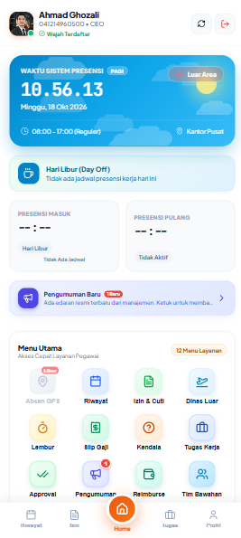

## Branch `odoo 18.0` — API baru (modul `ag_rest_api`, Odoo 18)

Branch ini mengadaptasi aplikasi ke **Odoo 18** dengan modul API baru
**`ag_rest_api`** (ditulis dari 0, bukan port modul Odoo 14). Semua URL
server terpusat di **`.env`** lewat `src/config.js` — tidak ada lagi URL
Odoo yang hardcoded di kode.

### Setup .env (wajib sebelum `npm run dev`)
```bash
cp .env.example .env
npm install
npm run dev
```
Isi `.env` (lihat `.env.example` untuk komentar lengkap):
- `VITE_ODOO_URL` — base URL Odoo 18 (default `https://odoo18.hiddenlab.me`;
  untuk test bed lokal: `http://127.0.0.1:8071`)
- `VITE_ODOO_DB` — nama database (default `tester`; jangan pakai `master`
  untuk uji — master adalah template perawan)
- `VITE_API_BASE` — prefix API (default `/ag_rest_api/v1`)
- `VITE_USE_MOCK` — `'true'` = mode mock (lihat bawah)

**Ganti database/target cukup dengan mengubah `.env` saja**, lalu
restart dev server. File `.env` asli tidak pernah di-commit (sudah di
`.gitignore`); yang di-commit hanya `.env.example` (nilai placeholder).

### Mode mock (tanpa server)
```bash
# di .env: VITE_USE_MOCK=true
npm run dev
```
Lapisan API (`src/services/api.js`) mengembalikan mock JSON lokal dari
`src/mocks/*.json` tanpa network — login memakai user mock (AG Test).
Cocok untuk demo / tes UI tanpa server Odoo.

### Alur auth (session Odoo)
1. Login: `POST /web/session/authenticate` bawaan Odoo
   (`{db, login, password}`) -> cookie sesi.
2. Semua endpoint data: `POST {VITE_API_BASE}/*` (JSON biasa) dengan
   cookie sesi (`credentials: 'include'`). Tanpa sesi -> JSON 401.
3. Tidak ada lagi Bearer token, password RPC di localStorage, maupun
   direct `/jsonrpc` execute_kw — semua sudah dihapus di branch ini.

### Catatan penting untuk APK
Cookie sesi Odoo tidak punya atribut SameSite sehingga browser/WebView
menganggapnya Lax: fetch lintas origin dari WebView Capacitor kemungkinan
**tidak** membawa cookie. Untuk APK produksi, sajikan API lewat origin
yang sama (reverse proxy satu origin). Jangan pernah mematikan auth
untuk mengatasi ini. (Catatan ini juga ada di `src/config.js`.)

### Build APK (tetap sama seperti dulu)
Lihat "How to Compile" di bawah. APK **tidak** dibangun di sandbox ini
(tanpa Android SDK) — build di PC dengan Android Studio/Gradle.

---

## Screenshots App
<div align="center">
  
</div>

## Features
- Deteksi akun dinonaktifkan secara realtime
- Pendaftaran wajah (Face Enrollment)
- Face descriptor
- Selfie recognition saat absen masuk & pulang
- Absen masuk & pulang dengan verifkasi geofence
- Tampilan peta lokasi kantor & radius radius presensi
- Capture foto selfie saat absen
- Anti spoofing: deteksi mock GPS
- Live tracking ping saat sesi clock-in aktif
- Status: Tepat Waktu, Terlambat, Cepat Pulang
- Detail riwayat per hari
- Tampilan jadwal shift / roster mingguan
- Notifikasi cuti & lembur di jadwal
- Indikator jam masuk & pulang
- Request tukar shift dengan rekan kerja
- Daftar pengumuman perusahaan
- Badge notifikasi unread count
- Preview dokumen lampiran inline
- Ajukan cuti dengan tanggal & alasan
- Ajukan izin keluar dengan alasan
- Ajukan lembur dengan durasi & alasan
- Status approval real-time
- List pengajuan reimbursement
- Detail pengajuan per item
- Histori slip gaji per periode
- Preview detail pembayaran
- Ringkasan denda yang berlaku
- Form laporan masalah / keluhan
- Status kehadiran bawahan realtime
- Kalender kehadiran tim
- KPI pegawai terbaru- Info device & session

## How to Compile
### For Android APP
- First compile for folder /dist
```bash  
   npm run build  
``` 
- Compile & sync android
```bash  
   npx cap sync android  
```
- Build apk
```bash  
   cd android; .\gradlew.bat assembleDebug  
```
- Folder output app
```bash
android\app\build\outputs\apk\debug\app-debug.apk
```